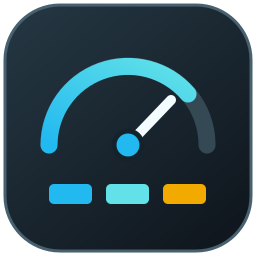

# Unraid Dashboard



Current maintenance build: **0.8.5 / 2026.10.22.04**. Read [safety, updates and R730xd/R360 migration guidance](docs/MAINTENANCE_AND_MIGRATION.md) before deployment.

Unraid Dashboard (formerly WAZ Control) is a custom Unraid dashboard and WebUI project built around one heavily customized server. The current unified build is **v0.8.5**.

> [!WARNING]
> **This is a reference build, not a universal or supported Community Applications plugin.** It depends on specific Unraid plugins, runtime files, sensors, hardware, and WebUI behavior. Expect to adapt configuration or code for another server. Read the [disclaimer](DISCLAIMER.md), [dependencies](docs/DEPENDENCIES.md), and [recovery steps](docs/RECOVERY.md) before installing it.


## What v0.8.5 includes

- Sticky full-width Health banner across Unraid WebUI pages
- Live Array, Storage, Cooling, and UPS state with an expandable fault-detail row
- Three matched Dashboard panels: Server Status, Workloads, and Storage
- Three-stage CPU display: socket summaries, physical cores, and individual threads, with remembered expansion choices
- CPU topology, per-thread use, rolling load history, RAM, GPU, networking, rack power, coolant, flow, and HBA temperatures
- Docker folders imported from FolderView Plus or Unraid's Docker Organizer
- Clickable container cards that retain Unraid's native controls and load a dynamic telemetry inspector
- Selected-container CPU, RAM, network, disk I/O, pool/share access, GPU activity, address, port, and status data
- Top four host/Docker CPU processes
- Compact parity state, last/next check timing, dynamic pools, physical disk locations, and an array table when an array is configured
- Decimal storage units and collection paths designed not to wake sleeping array disks
- One installable rolling plugin without permanent edits to Unraid core files
- Optional compact MD12xx fan status and controls in the header through the separate [MD12xx Fan Control](https://github.com/TheIlluminate92/unraid-md12xx-fan-control) plugin's local API
- API-provided shelf names, average RPM, controller health, Auto/Manual mode, targets, and supported manual speeds
- No WAZ-owned serial access, SES discovery, temperature policy, commissioning, watchdog, or fan-controller process

The Docker and Storage panels deliberately use dynamic detail windows. Selecting a Docker folder filters the visible containers; selecting a container loads its live details below. Selecting a pool loads only that pool's member disks while configured Array and physical Disk Location views remain visible. Pool-only servers hide the Array section.

## Install

The current artifact is [`releases/waz.dashboard.plg`](releases/waz.dashboard.plg). Install its raw GitHub URL through Unraid's **Plugins → Install Plugin** page; later releases are delivered through the normal plugin update controls. See [docs/INSTALL.md](docs/INSTALL.md).

Saved development builds and the original dashboard reference are retained for comparison. See [docs/VERSION_HISTORY.md](docs/VERSION_HISTORY.md). They are historical artifacts, not recommended installs.

## Source layout

```text
src/
├── waz-dashboard-plugin/  # unified plugin, panels, collectors, build and verification
└── waz-health-plugin/     # banner component source consumed by the unified build
```

The dashboard build intentionally keeps the banner component beside it and embeds that component under the single `waz.dashboard` runtime during packaging.

## Credit

Unraid Dashboard brings together data and behavior provided by Unraid/Dynamix, Docker Manager and Organizer, FolderView Plus, Disk Location, HBA Viewer, apcupsd/NUT, lm-sensors, and `intel_gpu_top`. See [docs/ATTRIBUTION.md](docs/ATTRIBUTION.md).

The layout, requirements, server-specific decisions, and testing were directed by TheIlluminate92. The PHP, JavaScript, CSS, collectors, packaging, and documentation were developed collaboratively with Codex by OpenAI.

## Support

No support is guaranteed. Pull requests are welcome, especially for clean auto-detection or documented hardware adaptations.

## License

MIT. See [LICENSE](LICENSE).

See [plugin registration and update behavior](docs/PLUGIN_UPDATES.md) before migrating duplicate entries. Use only the canonical installer filename; immutable versioned installers are audit artifacts.
